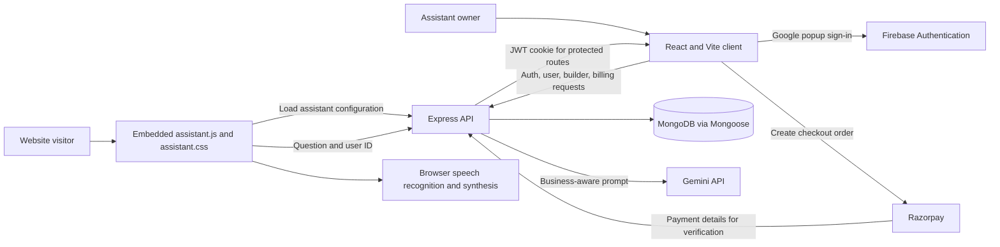

# VoxAI 🎙️

> ✨ **Give every website a voice.** A configurable AI voice assistant for business websites.

VoxAI is a MERN-style web application for building and embedding a voice-enabled assistant on a business website. Owners can configure the assistant's business profile, tone, appearance, and navigation targets. Visitors can ask questions by voice; the server sends a business-aware prompt to Gemini and can return either an AI response or a matching navigation action.

The assistant uses browser speech recognition for voice input and browser speech synthesis for spoken replies. Gemini provides concise, context-aware answers based on the configured business information.

> **Project status:** Local development implementation. The repository's live deployment URL and production configuration have not been verified.

## ✨ Features

- Configure an assistant name, business name/type/description, response tone, and visual theme.
- Choose one of three configured tones: `friendly`, `professional`, or `sales`.
- Choose one of four widget theme IDs: `light`, `dark`, `glass`, or `neon`.
- Add and remove named website pages, paths, and keywords for assistant navigation.
- Embed the assistant with a script tag generated by the Builder.
- Use browser speech recognition for visitor voice input and speech synthesis for spoken answers, where supported by the browser.
- Generate business-aware answers through the Gemini API; prompts request short replies suitable for voice playback.
- Match configured navigation keywords and return a navigation action when a supported intent is detected.
- Sign in through the frontend's Firebase Google popup flow; the server creates a JWT cookie for application requests.
- View account plan and usage information. The default Free plan allows 200 assistant messages; the Pro checkout flow charges INR 699 for 90 days.
- Use responsive React pages for Home, Login, Assistant Builder, and Billing.

## 🧰 Tech Stack

| Area | Technologies |
| --- | --- |
| Frontend | React 19, Vite 8, React Router, Tailwind CSS 4, Axios |
| Backend | Node.js, Express 5, Mongoose 9 |
| Database | MongoDB |
| AI | Gemini Generative Language API (`gemini-3.5-flash:generateContent` endpoint configured in the server) |
| Authentication | Firebase Google sign-in in the client; JWT in an HTTP-only cookie on the server |
| Payments | Razorpay SDK and payment-signature verification |
| Widget | Vanilla JavaScript/CSS embed, browser SpeechRecognition and SpeechSynthesis APIs |
| Development | Nodemon, ESLint, Vite |


## 🖼️ Screenshots

Add screenshots to `docs/screenshots/` and replace the placeholders below. This directory is not currently present in the repository.

| Page | Screenshot |
| --- | --- |
| Home and live assistant preview |  |
| Assistant Builder |  |
| Billing |  |
| Login |  |

## 🏗️ Architecture



The React client manages sign-in, configuration, account pages, and billing UI. The Express server exposes the API and reads/writes user and billing records in MongoDB. The embedded widget requests assistant configuration and sends visitor questions to the server. The server builds a prompt from the saved business profile and calls Gemini. Website navigation matches configured keywords against a visitor's spoken request.

## 📁 Repository Structure

The following structure is based on the current repository. `README.md` is at the repository root; some listed files are abbreviated for readability.

```text
VoxAI/
├── README.md
├── client/
│   ├── public/
│   │   ├── assistant.js
│   │   ├── assistant.css
│   │   ├── logo.png
│   │   └── mic.svg
│   ├── src/
│   │   ├── Components/
│   │   ├── pages/
│   │   ├── utils/
│   │   ├── assets/
│   │   ├── App.jsx
│   │   ├── index.css
│   │   └── main.jsx
│   ├── index.html
│   ├── package.json
│   └── vite.config.js
└── server/
    ├── Config/
    ├── Controllers/
    ├── Middleware/
    ├── Models/
    ├── Routes/
    ├── index.js
    └── package.json
```

The server's `Config/` contains database, JWT, Gemini, and Razorpay setup. Routes and controllers are separated by authentication, user, assistant, and billing concerns. The client has pages for Home, Login, Builder, and Billing, with Firebase setup in `src/utils/firebase.js`.

## ⚙️ Prerequisites

- Node.js and npm
- A MongoDB connection string
- A Firebase project configured for Google sign-in
- A Gemini API key (the app stores a key per user)
- Razorpay credentials to use the Pro payment flow

## 🚀 Installation and Setup

### 1. Clone the repository

```bash
git clone <YOUR_GITHUB_REPOSITORY_URL>
cd VoxAI
```

The repository URL is a placeholder because a GitHub URL was not provided.

### 2. Configure the server

Create `server/.env` with the following variables. Replace the example values locally; do not commit real secrets.

```dotenv
PORT=8000
MONGODB_URL=mongodb+srv://<username>:<password>@<cluster>/<database>
JWT_SECRET=<long-random-secret>
RAZORPAY_KEY_ID=<razorpay-key-id>
RAZORPAY_KEY_SECRET=<razorpay-key-secret>
```

`PORT` defaults to `5000` in the server, but the client currently targets `http://localhost:8000`, so use `8000` for the supplied local configuration unless you also update the client API URLs.

### 3. Configure the client

Create `client/.env`:

```dotenv
VITE_FIREBASE_API_KEY=<firebase-web-api-key>
VITE_RAZORPAY_KEY_ID=<razorpay-key-id>
```

Firebase's auth domain and project identifiers are currently configured in `client/src/utils/firebase.js`. Configure the Firebase project to allow the local and deployed client domains.

### 4. Install dependencies

```bash
cd server
npm install

cd ../client
npm install
```

## ▶️ Running the Project

Start the backend in one terminal:

```bash
cd server
npm run dev
```

The server uses `PORT`, or `5000` when `PORT` is unset. The client API base is currently `http://localhost:8000`, so configure `PORT=8000` for local use.

Start the frontend in another terminal:

```bash
cd client
npm run dev
```

Vite normally serves the client at `http://localhost:5173`. If that port is occupied, Vite may choose another port. The server's private API CORS allowlist currently contains only `http://localhost:5173`; add any alternate local or deployed client origin to `server/index.js` before using credentialed routes from that origin.

### Available package scripts

| Directory | Command | Purpose |
| --- | --- | --- |
| `client` | `npm run dev` | Start the Vite development server |
| `client` | `npm run build` | Create a production frontend build in `client/dist` |
| `client` | `npm run preview` | Preview the built frontend locally |
| `client` | `npm run lint` | Run ESLint |
| `server` | `npm run dev` | Run `nodemon index.js` |

There is no server `start` or production script in the current `server/package.json`. A deployment process for the Express backend has not been verified. Vercel is the stated deployment target, but the server currently starts with `app.listen`; confirm or adapt the backend deployment architecture before treating it as deployed.

## 🌐 Deployment Notes

Deployment to Vercel is planned, but no live deployment has been verified. Before deploying:

- Replace the hard-coded `localhost` API URLs in `client/src/App.jsx` and `client/public/assistant.js`.
- Update the server's CORS allowlist for the deployed client domain.
- Remove the demo assistant script and fixed user ID from `client/index.html`.
- Enable secure cookies for HTTPS and configure production environment variables.

Repository: `<YOUR_GITHUB_REPOSITORY_URL>` · Demo: `<YOUR_LIVE_DEMO_URL>`

## 🔌 API

Local API base: `http://localhost:8000`. Protected endpoints use the JWT cookie.

| Method | Endpoint | Purpose |
| --- | --- | --- |
| `POST` | `/api/auth/google` | Create/sign in a user and set a JWT cookie |
| `GET` | `/api/auth/logout` | Clear the JWT cookie |
| `GET` | `/api/user/current-user` | Get the signed-in user |
| `POST` | `/api/user/save-assistant` | Save assistant settings |
| `GET` | `/api/assistant/config/:userId` | Load public widget settings |
| `POST` | `/api/assistant/ask` | Get an AI reply or navigation action |
| `POST` | `/api/billing/order` | Create a Pro checkout order |
| `POST` | `/api/billing/verify` | Verify payment and update the plan |

Assistant settings include its name, business details, `tone`, `theme`, Gemini key, and optional pages with paths and keywords. For `/api/assistant/ask`, send `{ "message": "...", "userId": "..." }`. It returns an `aiResponse` or a navigation action. These assistant routes are currently public.

## 🧠 AI and Voice

1. The widget loads the saved assistant configuration.
2. Browser speech recognition captures a visitor's question and sends it to the server.
3. The server checks the user's plan, matches navigation keywords, or sends a business-aware prompt to Gemini.
4. The widget displays and reads the response aloud using browser speech synthesis.

Voice features depend on browser support. Gemini errors update the stored key status.

## 🔐 Security

- Keep MongoDB, JWT, and Razorpay secrets on the server. `VITE_` variables are public in the client build.
- The JWT cookie is HTTP-only, but currently uses `secure: false`; enable secure cookies for HTTPS.
- The Google sign-in endpoint accepts a name and email but does not verify a Firebase ID token yet.
- Assistant endpoints are public and have no rate limiting. Add validation and abuse protection before production.
- Review user responses, CORS origins, and environment settings before deployment.


## 👤 Author and Contact

- **Name:** `Sahil Kumar`
- **GitHub:** `https://github.com/sahilkumar720`
- **LinkedIn:** `<YOUR_LINKEDIN_PROFILE_URL>`
- **Contact:** `sahilkumar7369@gmail.com`

